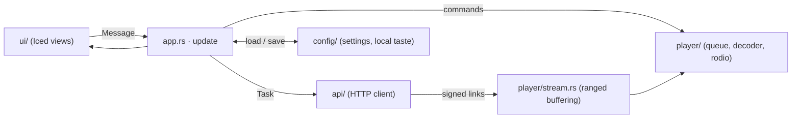

<p align="center">
  
</p>

<p align="center">
  <a href="https://github.com/psymariux/Psytify/actions/workflows/ci.yml"></a>
  <a href="https://github.com/psymariux/Psytify/actions/workflows/security.yml"></a>
  <a href="https://github.com/psymariux/Psytify/actions/workflows/codeql.yml"></a>
  <a href="LICENSE"></a>
  
</p>

<p align="center">
  <a href="README.md">English</a> · <b>Italiano</b>
</p>

**Psytify** è un player musicale nativo per desktop e Android, scritto in Rust. Resta leggero:
interfaccia nera, riproduzione lossless e un consumo di memoria e CPU contenuto anche mentre suona.

<p align="center">
  
  <br><sub>Illustrazione dell'interfaccia (le copertine sono disegnate, non sono uscite reali).</sub>
</p>

## In breve

- **Veloce e leggero.** Interfaccia nativa disegnata dalla GPU ([Iced](https://iced.rs)), senza web view
  né Electron. A riposo usa quasi zero CPU e non lavora a ogni frame.
- **Suona tutto.** FLAC, WAV, MP3, Ogg Vorbis e AAC/M4A con
  [Symphonia](https://github.com/pdeljanov/Symphonia) e [rodio](https://github.com/RustAudio/rodio),
  con ricerca nel brano anche mentre sta ancora scaricando.
- **Un'app, tre piattaforme.** Arch Linux (Wayland e X11), Windows 10/11 e Android con un'impaginazione
  pensata per il telefono.
- **Rispetta la musica.** Ogni brano ha la sua licenza; il download compare solo se la licenza lo
  consente e le fonti lossless hanno la precedenza.
- **Ascolto condiviso.** *Jam* fa suonare la stessa coda a un massimo di 8 persone, ciascuna dal proprio dispositivo.
- **Privato per progetto.** Playlist, "mi piace", artisti seguiti e ascolti stanno in un file locale. Il client
  parla con un solo indirizzo di backend e basta.

## Funzioni

| | |
|---|---|
| **Home** | Uscite recenti, carosello, artisti, novità non viste, brani popolari, mix e radio, composti sul dispositivo |
| **Cerca** | Ricerca nel catalogo e musica con licenza libera dall'Internet Archive |
| **Riproduzione** | Coda, casuale, ripeti, timer di spegnimento, autoplay, scelta della qualità |
| **Testi** | Testo sincronizzato nel pannello laterale e in una vista a tutto schermo |
| **Videoclip** | Videoclip facoltativo accanto all'audio (GStreamer), sincronizzato con pausa e ricerca |
| **Libreria** | Playlist locali, brani che ti piacciono, artisti seguiti, album salvati |
| **Download** | Salva un brano alla qualità scelta, se la licenza lo permette |
| **Integrazione col sistema** | Tasti multimediali e widget del desktop via MPRIS su Linux; controlli delle cuffie |
| **Account** | Accesso facoltativo con [Clerk](https://clerk.com) (OAuth 2.0 + PKCE nel browser) |

Keyboard: <kbd>Spazio</kbd> play/pausa · <kbd>←</kbd>/<kbd>→</kbd> ±5 s · <kbd>Ctrl</kbd>+<kbd>F</kbd> cerca. Il tasto <kbd>?</kbd> mostra tutte le scorciatoie.

## Installazione

> Psytify è un **client**: per cercare e suonare musica serve un backend compatibile. Vedi
> [Backend](#backend) e [Configurazione](#configurazione).

### Arch Linux

Costruisci e installa il pacchetto dal codice sorgente:

```bash
git clone https://github.com/psymariux/Psytify.git
cd Psytify
scripts/arch-package.sh --install
```

Lo script crea `psytify-<versione>-x86_64.pkg.tar.zst` in `dist/arch/` e anche il database di un
repository pacman (`psytify.db`), pronto da pubblicare.

### Binari già pronti

Le build per Linux e Windows, il pacchetto Arch e l'APK Android sono allegati a ogni
[release](https://github.com/psymariux/Psytify/releases), con `SHA256SUMS` e attestazioni di
provenienza (`gh attestation verify <file> --repo psymariux/Psytify`).

### Android

Scarica l'`.apk` dall'ultima release e aprilo sul telefono (consenti l'installazione dal browser o dal
gestore di file). Oppure compilalo tu: vedi [docs/ANDROID.md](docs/ANDROID.md).

### Compilare dal sorgente

Serve la toolchain Rust indicata in [`rust-toolchain.toml`](rust-toolchain.toml) (rustup la installa da
sé) e le librerie di sistema qui sotto.

| Sistema | Requisiti |
|---|---|
| Arch Linux | `alsa-lib wayland libxkbcommon libx11 libxcursor libxi libxrandr vulkan-icd-loader gstreamer gst-plugins-base gst-plugins-good gst-libav` |
| Debian / Ubuntu | `pkg-config libasound2-dev libxkbcommon-dev libwayland-dev libgstreamer1.0-dev libgstreamer-plugins-base1.0-dev` |
| Windows | Visual Studio Build Tools (MSVC) e il target `x86_64-pc-windows-msvc` |

```bash
cargo build -p psytify --release        # l'eseguibile è in target/release/psytify
cargo build -p psytify --release --no-default-features   # senza videoclip (non serve GStreamer)
```

## Configurazione

Il client parla con un solo backend. L'indirizzo si sceglie in quest'ordine:

1. la variabile d'ambiente `PSYTIFY_API_URL`;
2. `api_base_url` nel file di configurazione;
3. il valore compilato nel binario: `http://127.0.0.1:8080`, salvo che la build imposti
   `PSYTIFY_DEFAULT_API_URL` (vedi [`.env.build.example`](.env.build.example)).

```bash
PSYTIFY_API_URL=http://127.0.0.1:8080 psytify
```

| Sistema | File di configurazione |
|---|---|
| Linux | `~/.config/psytify/config.json` |
| Windows | `%APPDATA%\psytify\config.json` |

Il file conserva anche volume, qualità, coda, ultima schermata, playlist locali e artisti seguiti. I
download vanno in `<Download>/Psytify`.

<details>
<summary><b>Accesso facoltativo con Clerk</b></summary>

Crea nel pannello di Clerk un'applicazione OAuth **pubblica** (PKCE, scope `openid profile email`) con
redirect URI `http://127.0.0.1:53682/callback`, poi imposta `clerk_issuer` e `clerk_client_id` nel file
di configurazione, oppure le variabili `PSYTIFY_CLERK_ISSUER` e `PSYTIFY_CLERK_CLIENT_ID`. Il refresh
token sta in `session.json`, accanto alla configurazione, leggibile solo dal tuo utente.

</details>

## Backend

Psytify non distribuisce musica e non include un server. Parla una piccola API HTTP + JSON (catalogo,
ricerca, link firmati, testi, stanze jam) descritta in [docs/BACKEND.md](docs/BACKEND.md), quindi puoi
usare qualunque servizio compatibile. Il client apre connessioni solo verso quell'indirizzo: audio,
video e copertine passano tutti da lì.

> **Contenuti e diritti.** Psytify è un player. Chi gestisce un backend è responsabile dei contenuti
> che serve e deve avere i diritti per distribuirli.

## Architettura

L'app segue il pattern Elm su cui si basa Iced: uno stato `App`, un `Message` per ogni evento, un
`update` e una `view` che si limita a leggere.



| Percorso | Contenuto |
|---|---|
| `client/src/app.rs`, `client/src/app/` | `App`, `Message`, `update`, `subscription`; ascolto, libreria, artisti e fonti esterne |
| `client/src/ui/` | Componenti, pagine, scaffali, vista immersiva, testo sincronizzato, impaginazione da telefono; `theme.rs` contiene ogni colore e misura |
| `client/src/player/` | Coda (casuale, ripeti), stato di riproduzione, buffer con richieste `Range`, decoder Symphonia |
| `client/src/api/` | Client HTTP, modelli, rinnovo degli URL scaduti |
| `client/src/config/` | Impostazioni e gusti locali: artisti seguiti, album salvati, ascolti, mix |
| `android/` | Guscio `cdylib` (NativeActivity) che avvia il client con l'impaginazione da telefono |
| `docs/` | [Contratto del backend](docs/BACKEND.md), [stile visivo](docs/STYLE.md), [guida Android](docs/ANDROID.md), [brand kit](docs/brand/BRANDKIT.md) |

## Sviluppo

```bash
cargo fmt --all --check
cargo clippy --workspace --all-targets --locked -- -D warnings
cargo test --workspace --locked
```

Interruttori utili:

| Variabile | Effetto |
|---|---|
| `PSYTIFY_API_URL` | Indirizzo del backend per questa esecuzione |
| `PSYTIFY_PHONE=1` | Apre l'impaginazione da telefono in una finestra desktop |
| `PSYTIFY_DEFAULT_API_URL` | *In compilazione:* backend predefinito di una build di distribuzione |

L'interfaccia è descritta in [docs/STYLE.md](docs/STYLE.md): tre pannelli su nero, la copertina tinge lo
sfondo, il lime è il colore del marchio, niente effetti glass. Colori e misure vengono solo da
`ui/theme.rs`.

Leggi [CONTRIBUTING.md](CONTRIBUTING.md) prima di aprire una pull request: comprese le regole di
prestazioni, che fanno parte della revisione.

## Contribuire

Issue e pull request sono benvenute. Per tutto ciò che supera una piccola correzione apri prima una
issue, così si concorda la direzione prima di investire tempo. Il progetto segue il
[Codice di condotta](CODE_OF_CONDUCT.md). I problemi di sicurezza vanno segnalati in
[privato](SECURITY.md), non nelle issue pubbliche.

## Licenza

Psytify è software libero con [licenza GNU Affero General Public License v3.0](LICENSE).

L'interfaccia usa il carattere [Inter](https://rsms.me/inter/) con licenza
[SIL Open Font License 1.1](client/assets/fonts/OFL.txt). Psytify è costruito su
[Iced](https://github.com/iced-rs/iced), [rodio](https://github.com/RustAudio/rodio),
[Symphonia](https://github.com/pdeljanov/Symphonia), [Tokio](https://tokio.rs) and
[reqwest](https://github.com/seanmonstar/reqwest) — grazie ai loro autori.
