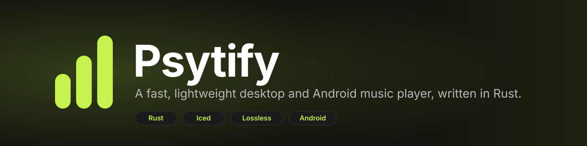
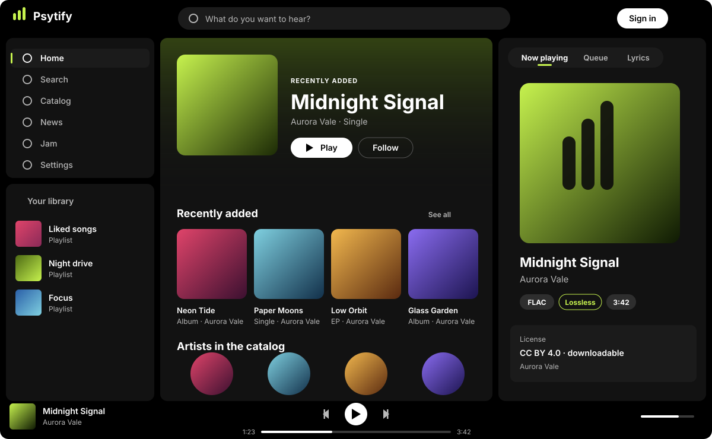
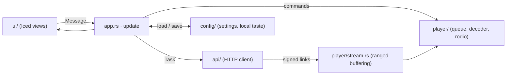

<p align="center">
  
</p>

<p align="center">
  <a href="https://github.com/psymariux/Psytify/actions/workflows/ci.yml"></a>
  <a href="https://github.com/psymariux/Psytify/actions/workflows/security.yml"></a>
  <a href="https://github.com/psymariux/Psytify/actions/workflows/codeql.yml"></a>
  <a href="LICENSE"></a>
  
</p>

**Psytify** is a native music player for the desktop and Android, written in Rust. It is built to
stay out of your way: a true-black interface, lossless playback, and a small memory and CPU
footprint even while it plays.

<p align="center">
  
  <br><sub>Illustration of the interface (artwork is generated, not real releases).</sub>
</p>

## Highlights

- **Fast and light.** Native GPU-rendered UI ([Iced](https://iced.rs)), no web view, no Electron.
  It idles at near-zero CPU and avoids per-frame work.
- **Plays everything.** FLAC, WAV, MP3, Ogg Vorbis and AAC/M4A through
  [Symphonia](https://github.com/pdeljanov/Symphonia) and [rodio](https://github.com/RustAudio/rodio),
  with instant seeking while a track is still downloading.
- **One app, three platforms.** Arch Linux (Wayland and X11), Windows 10/11, and Android with a
  layout designed for the phone.
- **Respects the music.** Every track carries its license; downloads are offered only when the
  license allows them, and lossless sources are preferred.
- **Listen together.** *Jam* lets up to 8 people play the same queue, each from their own device.
- **Italian interface for now.** The app's text is in Italian; the code, documentation and project
  conversation are in English.
- **Private by design.** Playlists, likes, follows and play counts live in a local file. The client
  talks to a single backend address and nothing else.

## Features

| | |
|---|---|
| **Home** | Recently added releases, a hero carousel, artists, news you have not seen, popular tracks, mixes and radio — composed on the device |
| **Search** | Catalog search, plus open-licensed music from the Internet Archive |
| **Playback** | Queue, shuffle, repeat, sleep timer, autoplay, quality selection |
| **Lyrics** | Time-synced lyrics in the side panel and in an immersive full-screen view |
| **Video clips** | Optional music video next to the audio (GStreamer), kept in sync with pause and seek |
| **Library** | Local playlists, liked songs, followed artists, saved albums |
| **Downloads** | Save a track at the quality you pick, when its license permits |
| **System integration** | Media keys and desktop widgets via MPRIS on Linux; headphone controls |
| **Account** | Optional sign-in with [Clerk](https://clerk.com) (OAuth 2.0 + PKCE in the browser) |

Keyboard: <kbd>Space</kbd> play/pause · <kbd>←</kbd>/<kbd>→</kbd> seek ±5 s · <kbd>Ctrl</kbd>+<kbd>F</kbd> search.

## Install

> Psytify is a **client**: it needs a compatible backend to browse and play music. See
> [Backend](#backend) and [Configuration](#configuration).

### Arch Linux

Build and install the package straight from the source tree:

```bash
git clone https://github.com/psymariux/Psytify.git
cd Psytify
scripts/arch-package.sh --install
```

The script builds `psytify-<version>-x86_64.pkg.tar.zst` in `dist/arch/` and also creates a pacman
repository database (`psytify.db`) there, ready to host.

### Prebuilt binaries

Linux and Windows builds, the Arch package and the Android APK are attached to every
[release](https://github.com/psymariux/Psytify/releases), with `SHA256SUMS` and build-provenance
attestations (`gh attestation verify <file> --repo psymariux/Psytify`).

### Android

Download the `.apk` from the latest release and open it on the phone (allow installs from your
browser or file manager). Or build it yourself: see [docs/ANDROID.md](docs/ANDROID.md).

### Build from source

You need the Rust toolchain pinned in [`rust-toolchain.toml`](rust-toolchain.toml) (rustup installs
it automatically) and the system libraries below.

| System | Prerequisites |
|---|---|
| Arch Linux | `alsa-lib wayland libxkbcommon libx11 libxcursor libxi libxrandr vulkan-icd-loader gstreamer gst-plugins-base gst-plugins-good gst-libav` |
| Debian / Ubuntu | `pkg-config libasound2-dev libxkbcommon-dev libwayland-dev libgstreamer1.0-dev libgstreamer-plugins-base1.0-dev` |
| Windows | Visual Studio Build Tools (MSVC) and the `x86_64-pc-windows-msvc` target |

```bash
cargo build -p psytify --release        # binary in target/release/psytify
cargo build -p psytify --release --no-default-features   # without video clips (no GStreamer needed)
```

## Configuration

The client talks to one backend. The address is resolved in this order:

1. the `PSYTIFY_API_URL` environment variable;
2. `api_base_url` in the configuration file;
3. the default compiled into the binary: `http://127.0.0.1:8080` unless the build sets
   `PSYTIFY_DEFAULT_API_URL` (see [`.env.build.example`](.env.build.example)).

```bash
PSYTIFY_API_URL=http://127.0.0.1:8080 psytify
```

| System | Configuration file |
|---|---|
| Linux | `~/.config/psytify/config.json` |
| Windows | `%APPDATA%\psytify\config.json` |

The file also stores volume, quality, queue, last screen, local playlists and follows. Downloads go
to `<Downloads>/Psytify`.

<details>
<summary><b>Optional sign-in with Clerk</b></summary>

Create a **public** OAuth application in your Clerk dashboard (PKCE, scopes `openid profile email`)
with the redirect URI `http://127.0.0.1:53682/callback`, then set `clerk_issuer` and
`clerk_client_id` in the configuration file, or the `PSYTIFY_CLERK_ISSUER` and
`PSYTIFY_CLERK_CLIENT_ID` environment variables. The refresh token is stored in `session.json`
next to the configuration, readable only by your user.

</details>

## Backend

Psytify does not ship music and does not include a server. It speaks a small HTTP + JSON API
(catalog, search, signed media links, lyrics, jam rooms) described in
[docs/BACKEND.md](docs/BACKEND.md), so you can run any compatible service. The client only ever
opens connections to that one address: audio, video and cover art all come through it.

> **Content and rights.** Psytify is a player. Whoever operates a backend is responsible for the
> content it serves and must hold the rights to distribute it.

## Architecture

The app follows the Elm pattern that Iced is built around: one `App` state, a `Message` for every
event, a pure `update`, and a `view` that only reads.



| Path | What lives there |
|---|---|
| `client/src/app.rs`, `client/src/app/` | `App`, `Message`, `update`, `subscription`; listening, library, artists and external sources |
| `client/src/ui/` | Components, pages, shelves, immersive view, synced lyrics, phone layout; `theme.rs` holds every color and size token |
| `client/src/player/` | Queue (shuffle, repeat), playback state, ranged streaming buffer, Symphonia decoder |
| `client/src/api/` | HTTP client, models, signed-URL renewal |
| `client/src/config/` | Settings and local taste: follows, saved albums, play counts, mixes |
| `android/` | Thin `cdylib` shell (NativeActivity) that starts the client with the phone layout |
| `docs/` | [Backend contract](docs/BACKEND.md), [visual style](docs/STYLE.md), [Android guide](docs/ANDROID.md), [brand kit](docs/brand/BRANDKIT.md) |

## Development

```bash
cargo fmt --all --check
cargo clippy --workspace --all-targets --locked -- -D warnings
cargo test --workspace --locked
```

Handy switches:

| Variable | Effect |
|---|---|
| `PSYTIFY_API_URL` | Backend address for this run |
| `PSYTIFY_PHONE=1` | Open the phone layout in a desktop window |
| `PSYTIFY_DEFAULT_API_URL` | *Compile time:* backend baked into a distribution build |
| `PSYTIFY_DEFAULT_CLERK_ISSUER`, `PSYTIFY_DEFAULT_CLERK_CLIENT_ID` | *Compile time:* Clerk sign-in (Frontend API and public OAuth client ID) baked into a distribution build |

The interface is documented in [docs/STYLE.md](docs/STYLE.md): three panels on black, the cover art
tints the background, lime is the brand color, no glass effects. Colors and sizes come only from
`ui/theme.rs`.

Read [CONTRIBUTING.md](CONTRIBUTING.md) before opening a pull request — including the performance
rules, which are part of the review.

## Contributing

Issues and pull requests are welcome. Please open an issue first for anything bigger than a small
fix, so the direction can be agreed before you invest time. Be kind: the project follows the
[Code of Conduct](CODE_OF_CONDUCT.md). Security problems go through
[private reporting](SECURITY.md), not public issues.

## License

Psytify is free software under the [GNU Affero General Public License v3.0](LICENSE).

The interface uses the [Inter](https://rsms.me/inter/) typeface under the
[SIL Open Font License 1.1](client/assets/fonts/OFL.txt). Psytify is built on
[Iced](https://github.com/iced-rs/iced), [rodio](https://github.com/RustAudio/rodio),
[Symphonia](https://github.com/pdeljanov/Symphonia), [Tokio](https://tokio.rs) and
[reqwest](https://github.com/seanmonstar/reqwest) — thank you to their authors.
